# Web-Media-Player

**A complete video player for the web, built for React.** It plays MKV, HEVC, AC-3, DTS, every
audio track and the subtitles inside the file, right in the browser, with the controls people
expect from a streaming app.

[](https://www.npmjs.com/package/@roshan-here/web-media-player)
[](LICENSE)


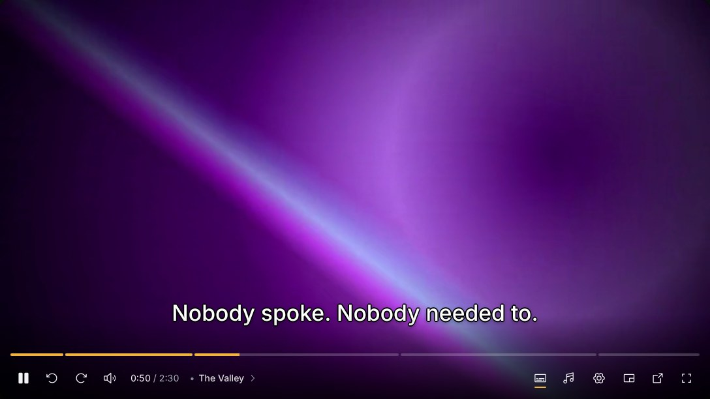

Browsers' own `<video>` plays MP4 and WebM with a handful of codecs, shows one audio track and
ignores the subtitles inside a file. Web-Media-Player decodes in the page with
[Web-Buildin-decoder](https://github.com/Roshan-Here/Web-Buildin-decoder) (FFmpeg in
WebAssembly, WebCodecs for the picture), and falls back to the browser's own decoder when that
is all a file needs. Around it is a full player: a timeline with chapters and previews, menus
for audio and subtitles, a subtitle look panel, picture in picture, a miniplayer, "Skip
intro", Up Next, keyboard shortcuts, and a stylesheet that never touches your page.

Created by **[Roshan-Here](https://github.com/Roshan-Here)**.

## Contents

- [Features](#features)
- [Screenshots](#screenshots)
- [Install](#install)
- [Quick start](#quick-start)
- [Guide](#guide)
- [Props](#props)
- [Keyboard shortcuts](#keyboard-shortcuts)
- [Bundlers and hosting](#bundlers-and-hosting)
- [Demo and development](#demo-and-development)
- [Credits](#credits)
- [License](#license)

## Features

- **Plays what browsers don't.** MP4, WebM, MKV, AVI and MPEG-TS; H.264, HEVC, VP9 and AV1;
  AAC, AC-3, E-AC-3, DTS, TrueHD and Opus. HEVC without a hardware decoder switches to software
  decoding on its own.
- **Every track.** Switch audio tracks while playing; show the file's own subtitles (SRT,
  ASS/SSA, WebVTT, MP4 text) or subtitle files you pass in.
- **A timeline that helps.** Chapters as segments, a preview of the scene under the pointer,
  the chapter's name over the time, and seeking that merges a burst of clicks or key presses
  into one seek.
- **Subtitles from the web.** "Search online" in the Subtitles menu finds subtitles on
  OpenSubtitles (and SubDL, with the viewer's own key), best match first by file hash, show and
  episode, and keeps them in the browser. Or plug in your own source.
- **Subtitles your way.** Size, colour, background box, edge, position and typeface, plus
  timing per video, all remembered.
- **Streaming-app touches.** "Skip intro" (and recap, opening, credits), an Up Next card and
  countdown, "Still watching?", a pre-roll with backdrop and poster while the video opens.
- **Picture in picture** in a floating window with its own controls (Chrome and Edge), the
  system's elsewhere, and a **miniplayer** layout that docks in a corner without a hitch.
- **Plays from anywhere.** A URL (any server with Range requests), a file from the viewer's
  computer, or your own storage through a small interface.
- **Accessible.** Real buttons, an ARIA slider for the timeline, menus with arrow keys,
  captions announced politely, and reduced motion honoured.
- **Fits in.** One stylesheet with `mp:`-prefixed classes and `--mp-*` variables: it cannot
  clash with your CSS, and your CSS cannot break it. Theme it with an accent colour or CSS
  variables; translate every label.

## Screenshots

All taken from the [demo](#demo-and-development), playing an HEVC + AC-3 Matroska file.

|                                                                                                                               |                                                                                                                         |
| :---------------------------------------------------------------------------------------------------------------------------: | :---------------------------------------------------------------------------------------------------------------------: |
| 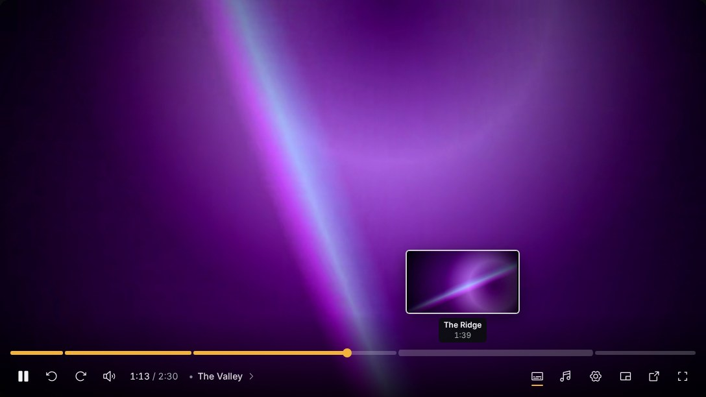 | 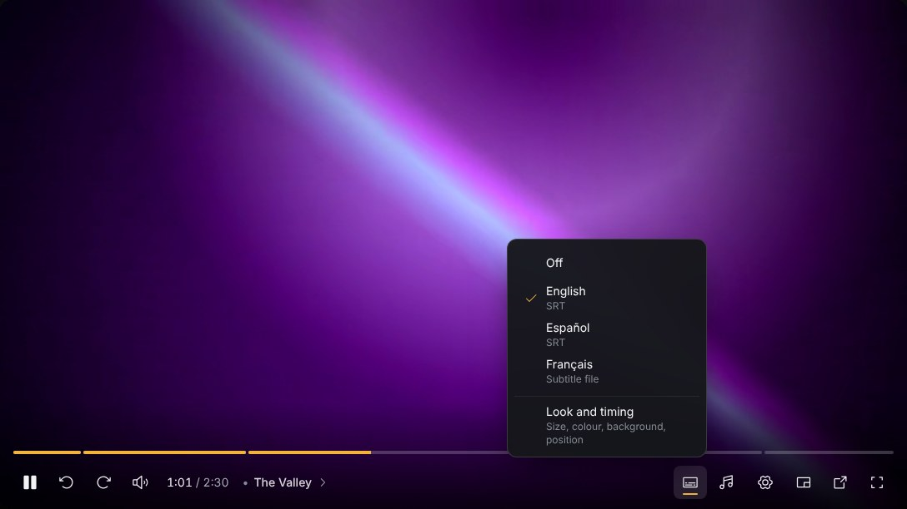 |
|                     **Timeline previews and chapters.** Hover to see the scene, its chapter and its time.                     |                     **Subtitles.** The file's own tracks and subtitle files you pass, side by side.                     |
|       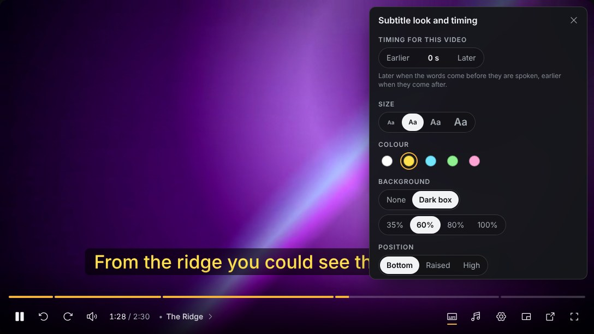        |                  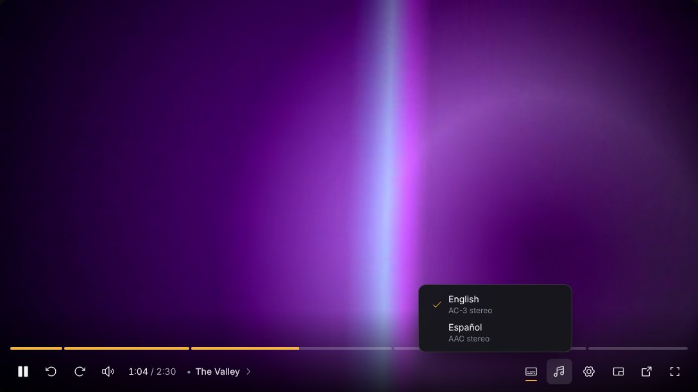                   |
|                     **Subtitle look and timing.** Changes show on the subtitle behind the panel at once.                      |                         **Audio tracks.** Every track in the file, named by language and codec.                         |
|              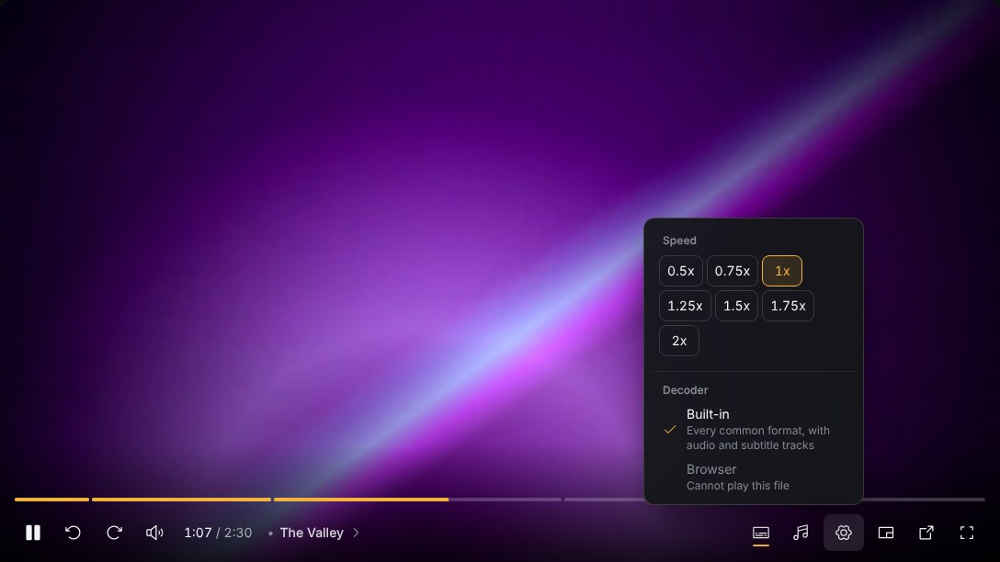               |      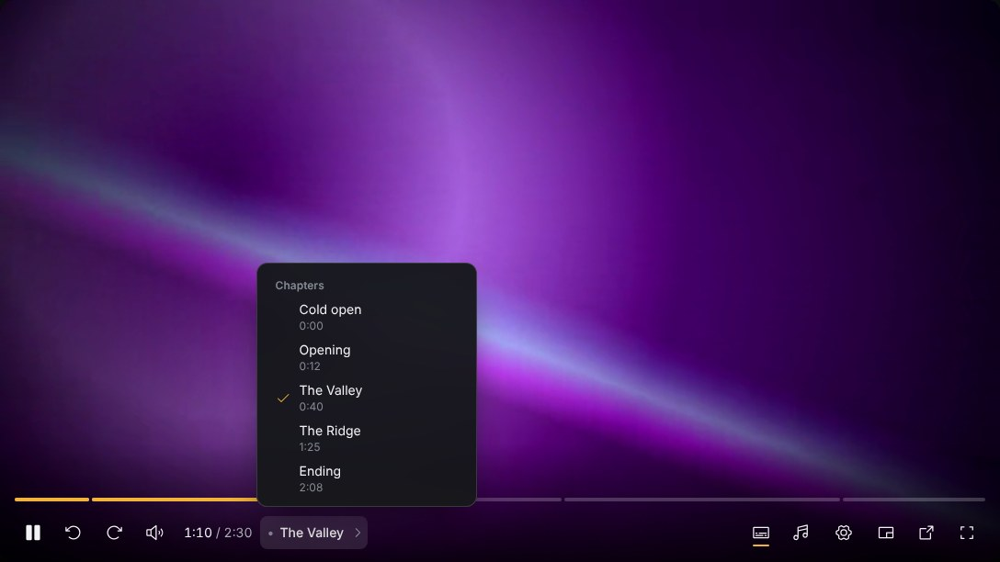       |
|                       **Speed and decoder.** The browser decoder is offered only for what it can play.                        |                               **Chapters.** Read from the file; jump with Shift + arrows.                               |
|                       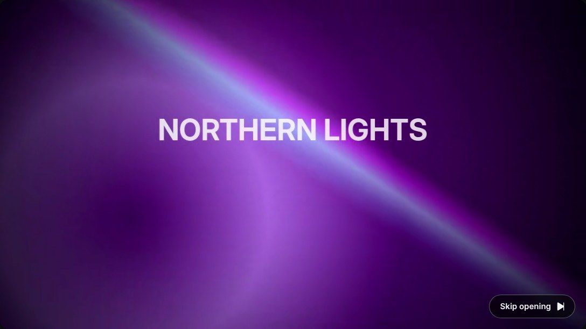                       |                         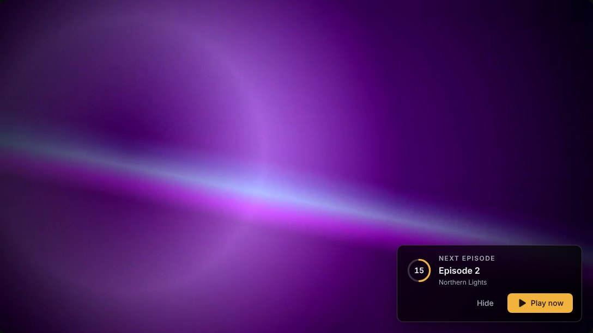                          |
|                       **Skip intro.** From times you pass, or from chapters named "Opening", "Credits"…                       |                 **Up Next.** A card near the end, then a countdown, with "Still watching?" after a few.                 |
|         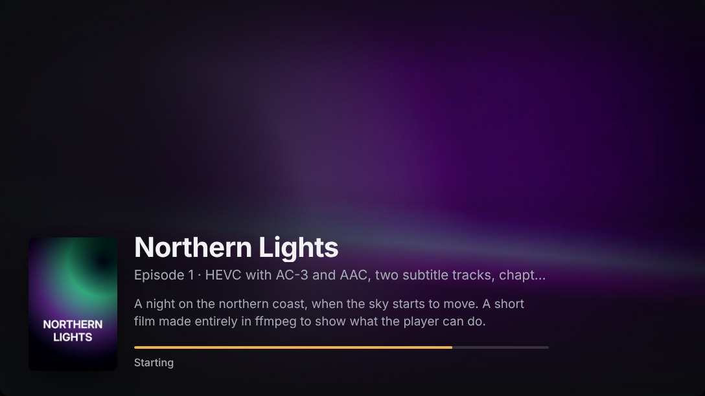          |                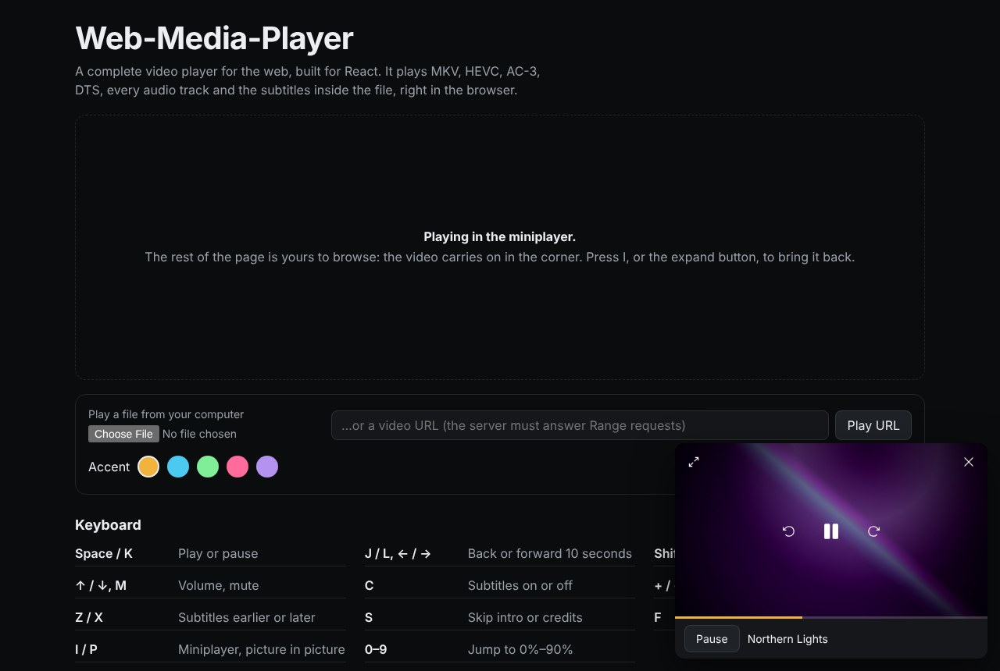                |
|                              **Pre-roll.** Backdrop, poster and overview while the video opens.                               |                     **Miniplayer.** Docks in a corner and keeps playing while the page is browsed.                      |

## Install

```sh
npm install @roshan-here/web-media-player web-buildin-decoder movi-player@0.4
```

React 18 or newer. `web-buildin-decoder` does the decoding and `movi-player` is its engine; npm
7 and newer install them with the player, and listing them makes it explicit.

## Quick start

```tsx
import { Player } from '@roshan-here/web-media-player'
import '@roshan-here/web-media-player/style.css'

export function Watch() {
  return (
    <Player
      source={{ url: 'https://example.com/films/northern-lights.mkv' }}
      title="Northern Lights"
    />
  )
}
```

That is a working player: it opens the file, starts playing (muted with a "Turn on sound"
button if the browser refuses sound), lists the audio and subtitle tracks and the chapters, and
remembers the viewer's volume and choices. Using Vite? Add one line to its config, see
[Bundlers and hosting](#bundlers-and-hosting).

## Guide

### Sources

```tsx
// Any server that answers Range requests (static hosts, S3, R2, most CDNs).
<Player source={{ url: '/videos/film.mkv' }} />

// With headers, cookies, or a known size (saves one request).
<Player source={{ url, http: { headers: { Authorization: `Bearer ${token}` }, credentials: 'include' } }} />

// A file the viewer picked: nothing is uploaded, it plays from their disk.
<input type="file" onChange={(e) => setSource({ file: e.target.files![0]! })} />
<Player source={source} />

// Your own storage: return a ByteSource (see Web-Buildin-decoder's ChunkedSource).
<Player source={{ key: id, open: async () => myChunkedSource(id) }} />
```

`key` is the video's stable id, used for remembered subtitle timing; the URL or the file's name
and size are used when it is absent. `fileName` and `mimeType` help pick the decoder when the
URL has no extension.

Your own bytes can reach the browser decoder too: `openUrl` is called each time it starts and
returns an address made for them (a Service Worker stream over `open`, say), with a `release`
for when it stops. Returning null hands the video to the built-in decoder.

The browser decoder's timeline previews play the same address in a second, hidden `<video>`.
Give `previewUrl` when they should read elsewhere: a function is called on the first preview,
so it can set up what that address serves (a Service Worker stream with a reader of its own,
say), and its `release` runs when the player lets the video go. `false` turns them off.

```tsx
<Player
  source={{
    url: streamUrl(id),
    previewUrl: () => ({
      url: streamUrl(`${id}~preview`),
      release: () => stopStream(`${id}~preview`),
    }),
  }}
/>
```

### Subtitle files

```tsx
<Player
  source={{ url: '/videos/film.mkv' }}
  subtitles={[
    { label: 'Français', language: 'fr', src: '/subs/film.fr.vtt' },
    { label: 'Deutsch', language: 'de', src: '/subs/film.de.srt', default: true },
    { label: 'Notes', text: '1\n00:00:01,000 --> 00:00:04,000\nHello' },
  ]}
/>
```

SRT, WebVTT, ASS and SSA are read; the format comes from the name or the text. Files load when
chosen. They sit in the Subtitles menu with the video's own tracks, and follow the same look
and timing.

### Subtitles from the web

Give the player a subtitle service and the Subtitles menu gains "Search online": a panel
listing what the service has for the video, best first. The one chosen shows in place of the
video's own tracks, with the same look and timing, and the next episode of the same show
searches in its language first.

```tsx
import { createOnlineSubtitles, Player } from '@roshan-here/web-media-player'

// Once, at start up. The key is your app's, from opensubtitles.com (API consumers).
const subtitles = createOnlineSubtitles({
  apiKey: import.meta.env.VITE_OPENSUBTITLES_KEY,
  appName: 'My Player',
  appVersion: '1.0',
})

<Player source={source} title={title} onlineSubtitles={{ service: subtitles }} />
```

What it searches for comes from the video: the file's name (or `onlineSubtitles.name`), any
`caption` text posted with it for a show, season and episode a file name lacks, and the
OpenSubtitles hash of the file's two ends, read without disturbing playback, for an exact
match. Pass `languages` (best first) to choose the languages; otherwise it is the one last
chosen for that show, the browser's, then English.

OpenSubtitles allows a few downloads a day without an account. A settings page can sign the
viewer in for their own quota, and add a SubDL key as a second source, with the same service:

```tsx
const status = subtitles.status() // { kind: 'signedIn', username, remaining, allowed }, ...
await subtitles.signIn(username, password) // { kind: 'ok' } | { kind: 'wrongPassword' } | ...
subtitles.signOut()
subtitles.setSubdlKey(key)
const line = statusText({ t: makeTranslate(defaultLabels) }, status) // "Signed in as ..."
```

The account and quota figures are kept in `localStorage`, and searches and files in IndexedDB
for up to six months, so the same subtitle never costs a second download. `accountKey` and
`cacheName` choose where.

**Your own source.** Anything with these four methods works, from your own server to a folder
of files:

```ts
const mine: OnlineSubtitleService = {
  search: async (target) => ({
    hits: await findFor(target.name, target.languages),
    notice: null,
    fromCache: false,
  }),
  download: async (hit) => ({
    kind: 'done',
    subtitle: { extension: 'srt', text: await fetchText(hit.id) },
    label: hit.language,
    fromCache: false,
  }),
  cachedIds: async () => new Set(),
  blockedFor: () => null,
}
```

`makeHit({ provider: 'Mine', id, language, release })` fills in the rest of a hit. The panel's
words are labels like the rest (`onlineTitle`, `onlineNotice...`), and a label may be a
function for languages whose plurals need one.

### Chapters, Skip intro and Up Next

```tsx
<Player
  source={source}
  // Instead of the file's own chapters, or for a video without any:
  chapters={[
    { title: 'Intro', start: 0, end: 0 },
    { title: 'Act one', start: 92, end: 0 },
  ]}
  // "Skip intro" and friends; without these, chapters named Opening, Credits... are used.
  skipSegments={[
    { kind: 'intro', start: 32, end: 92 },
    { kind: 'credits', start: 2610, end: null }, // null: to the end of the file
  ]}
  upNext={{
    title: 'Northern Lights',
    label: 'S1 E2 · The Valley',
    play: (auto) => goToEpisode(2),
    prepare: () => prefetchEpisode(2), // optional: start fetching when the card shows
    shouldAsk: () => false, // or createStillWatching().shouldAsk
  }}
/>
```

The Up Next card appears in the last 30 seconds, or from where the closing credits begin.
`createStillWatching()` counts episodes that played by themselves and asks "Still watching?"
after three in a row with nobody touching anything:

```ts
import { createStillWatching } from '@roshan-here/web-media-player'
const stillWatching = createStillWatching(3)

const upNext = {
  /* ... */
  play: (auto: boolean) => {
    if (auto) stillWatching.autoplayed()
    goToEpisode(n + 1)
  },
  shouldAsk: stillWatching.shouldAsk,
}
```

### The pre-roll

```tsx
<Player
  source={source}
  loader={{
    title: 'Northern Lights',
    line: 'S1 E1 · 2026 · 2m 30s',
    overview: 'A night on the northern coast, when the sky starts to move.',
    backdrop: '/art/backdrop.jpg', // 16:9
    poster: '/art/poster.jpg', // 2:3
  }}
/>
```

Shown while the video opens, with a progress line, then faded off once it plays. Without it, the
`poster` prop (if any) shows dimmed with a spinner.

### The miniplayer

Keep one `<Player>` mounted and change its `layout`; playback carries on without a hitch.

```tsx
const [mini, setMini] = useState(false)

<div className={mini ? 'docked' : 'inline'}>
  <Player
    source={source}
    layout={mini ? 'mini' : 'page'}
    onToggleMiniplayer={() => setMini((m) => !m)} // shows the button, and the I key
    onClose={() => stopPlayback()}
    renderMiniBar={({ paused, togglePlay }) => <MyMiniBar paused={paused} onToggle={togglePlay} />}
  />
</div>
```

```css
.docked {
  position: fixed;
  right: 16px;
  bottom: 16px;
  width: 400px;
  z-index: 50;
}
```

### Theming

```tsx
<Player source={source} accentColor="#e50914" />
```

Or set the design tokens with CSS, on `.mp-root` or any element around the player:

```css
.mp-root {
  --mp-color-accent: #4cc9f0;
  --mp-color-accent-hover: #7dd8f5;
  --mp-color-accent-ink: #04141b; /* text on the accent */
  --mp-color-surface: #121418; /* menus and panels */
  --mp-font-body: 'Inter', system-ui, sans-serif;
  --mp-radius-control: 10px;
}
```

| Variable                                                                | Used for                                                       |
| ----------------------------------------------------------------------- | -------------------------------------------------------------- |
| `--mp-color-accent`, `--mp-color-accent-hover`, `--mp-color-accent-ink` | Progress, selection, primary buttons                           |
| `--mp-color-bg`, `--mp-color-surface`, `--mp-color-raised`              | Grounds, menus and panels, hovered rows                        |
| `--mp-color-ink`, `--mp-color-muted`, `--mp-color-faint`                | Text, secondary text, hints                                    |
| `--mp-color-line`, `--mp-color-line-strong`                             | Borders                                                        |
| `--mp-color-danger`, `--mp-color-shadow`                                | Error icon, shadows                                            |
| `--mp-font-body`, `--mp-radius-control`                                 | Typeface, button and menu corners                              |
| `--mp-overlay-top`                                                      | Room to keep clear at the top (a header lying over the player) |

By default the player is a 16:9 box as wide as its parent; `fit="fill"` fills a parent you size.

### Translating

Every word the player shows or reads out is a label. Pass the ones you translate; the rest stay
English. `{name}` is filled in.

```tsx
<Player
  source={source}
  labels={{
    play: 'Lecture',
    pause: 'Pause',
    subtitles: 'Sous-titres',
    skipIntro: "Passer l'intro",
    seekValue: '{position} sur {duration}',
  }}
/>
```

`defaultLabels` (exported) lists all of them. A label can also be a function of its values,
for plurals and word order a template cannot express:

```tsx
labels={{ onlineDownloads: ({ count }) => (count === 1 ? '1 téléchargement' : `${count} téléchargements`) }}
```

### Controlling it from code

```tsx
const player = useRef<PlayerHandle>(null)

<Player ref={player} source={source} onEnded={next} onProgress={(at, length) => save(at)} />

player.current?.seekTo(90)
player.current?.pause()
player.current?.media?.addEventListener('timeupdate', ...) // behaves like a <video>
navigator.clipboard.writeText(player.current!.diagnostics()) // for a bug report
```

### Remembered settings

Volume, the decoder, the last audio and subtitle languages, the subtitle look and each video's
subtitle timing are kept in `localStorage` under `web-media-player:`. Change or turn that off once,
before rendering:

```ts
import { configureStorage } from '@roshan-here/web-media-player'

configureStorage({ storage: false }) // remember nothing
configureStorage({ prefix: 'myapp:player:' }) // another prefix
configureStorage({ storage: mySyncedStore }) // anything with getItem and setItem
```

`rememberSettings={false}` on a player turns off its subtitle timing and track languages only.

The subtitle look is shared by every player on the page. Put it in your own settings page with
the same controls the player uses:

```tsx
import {
  SubtitlePreview,
  SubtitleStyleControls,
  subtitleStyle,
  useSubtitleStyle,
} from '@roshan-here/web-media-player'

function SubtitleSettings() {
  const style = useSubtitleStyle()
  return (
    <div className="mp-root">
      <SubtitlePreview value={style} />
      <SubtitleStyleControls value={style} onChange={(change) => subtitleStyle.set(change)} />
    </div>
  )
}
```

Outside a player, wrap them in `<LabelsProvider labels={...}>` to give them your translation, as
the player's `labels` prop does inside it. The pre-roll, `PlayerLoader` (with `loaderStatus` for
its status line), can be shown the same way on a placeholder before the player itself arrives,
so nothing jumps when it does.

## Props

| Prop                 | Type                             | Default                | What it does                                                                        |
| -------------------- | -------------------------------- | ---------------------- | ----------------------------------------------------------------------------------- |
| `source`             | `PlayerSource`                   | required               | `url`, `file` or `open`, with `key`, `fileName`, `mimeType`, `http`, `isPermanent`  |
| `title`              | `string`                         | `''`                   | For screen readers, full screen, picture in picture, media controls                 |
| `poster`             | `string`                         |                        | Shown dimmed while the video opens; artwork for media controls                      |
| `startAt`            | `number`                         | `0`                    | Seconds to start from                                                               |
| `autoPlay`           | `boolean`                        | `true`                 | Start as soon as it can (muted if sound is refused)                                 |
| `decoder`            | `'builtin' \| 'browser'`         | remembered             | The decoder to start with                                                           |
| `browserCanPlay`     | `boolean`                        | detected               | Whether to offer the browser decoder                                                |
| `subtitles`          | `SubtitleFile[]`                 |                        | Subtitle files to offer                                                             |
| `onlineSubtitles`    | `OnlineSubtitlesOptions`         |                        | "Search online": `service`, and optionally `name`, `caption`, `languages`, `locale` |
| `chapters`           | `ChapterMark[]`                  | the file's             | Chapters to use instead of the file's own                                           |
| `skipSegments`       | `SkipSegment[]`                  | from chapters          | Stretches to offer "Skip" for                                                       |
| `skipButton`         | `boolean`                        | `true`                 | Show the Skip button                                                                |
| `upNext`             | `UpNext`                         |                        | The next episode                                                                    |
| `autoplayNext`       | `boolean`                        | `true`                 | Offer and play `upNext` by itself                                                   |
| `loader`             | `LoaderInfo`                     |                        | The pre-roll                                                                        |
| `layout`             | `'page' \| 'mini'`               | `'page'`               | Full player or miniplayer                                                           |
| `onToggleMiniplayer` | `() => void`                     |                        | Shows the miniplayer button; switches layout                                        |
| `onClose`            | `() => void`                     |                        | Mini layout: the close button                                                       |
| `renderMiniBar`      | `(controls) => ReactNode`        |                        | Mini layout: a bar under the picture                                                |
| `fit`                | `'aspect' \| 'fill'`             | `'aspect'`             | 16:9 box, or fill the parent                                                        |
| `keyboard`           | `'focused' \| 'global' \| 'off'` | `'focused'`            | Where shortcuts work                                                                |
| `rememberSettings`   | `boolean`                        | `true`                 | Remember timing and track languages                                                 |
| `labels`             | `Partial<PlayerLabels>`          | English                | Text, for translation                                                               |
| `accentColor`        | `string`                         | `#f2b33d`              | The accent colour                                                                   |
| `wasmUrl`            | `string`                         | emitted by the bundler | Where `movi.wasm` is served                                                         |
| `onProgress`         | `(position, duration) => void`   |                        | Every few seconds, and on pause                                                     |
| `onEnded`            | `() => void`                     |                        | The video played to its end                                                         |
| `onError`            | `(failure) => void`              |                        | Playback failed for good                                                            |
| `onEngine`           | `(engine) => void`               |                        | The engine playing, for advanced use                                                |
| `className`, `style` |                                  |                        | On the player's root                                                                |
| `ref`                | `PlayerHandle`                   |                        | `media`, `engine`, `play`, `pause`, `seekTo`, `toggleFullscreen`, `diagnostics`     |

## Keyboard shortcuts

With `keyboard="focused"` (the default) they work once the viewer has clicked or tabbed into the
player; `keyboard="global"` makes them work anywhere on the page, for a page that is all about the
video.

| Key           | Does                                           |
| ------------- | ---------------------------------------------- |
| Space, K      | Play or pause                                  |
| J, ← / L, →   | Back or forward 10 seconds                     |
| Shift + ← / → | Previous or next chapter                       |
| ↑ / ↓         | Volume                                         |
| M             | Mute                                           |
| C             | Subtitles on or off                            |
| + / −         | Subtitle size                                  |
| Z / X         | Subtitles earlier or later                     |
| S             | Skip intro, recap or credits                   |
| F             | Full screen                                    |
| I             | Miniplayer (or picture in picture without one) |
| P             | Picture in picture                             |
| 0–9           | Jump to 0%–90%                                 |

## Bundlers and hosting

**Vite.** Production builds emit `movi.wasm` by themselves. In development, keep movi-player out
of dependency pre-bundling:

```ts
// vite.config.ts
export default defineConfig({ optimizeDeps: { exclude: ['movi-player'] } })
```

**webpack 5 and Parcel 2** emit `movi.wasm` by themselves. **Anything else**: copy
`node_modules/movi-player/dist/movi.wasm` to your site and pass `wasmUrl="/movi.wasm"`.

**Next.js and other server rendering.** The player runs in the browser; render it in a client
component (`'use client'`), or load it with `next/dynamic` and `ssr: false`.

**Content-Security-Policy.** The decoder needs `script-src 'wasm-unsafe-eval'`,
`worker-src blob:`, and `img-src blob:` and `media-src blob:` for previews and picture in
picture; `connect-src` must allow your video hosts. See
[Web-Buildin-decoder](https://github.com/Roshan-Here/Web-Buildin-decoder#bundlers-hosting-and-security-headers).

**Browsers.** Made for current Chrome, Edge, Firefox and Safari; the automated checks run in
Chromium. The built-in decoder needs WebAssembly and uses WebCodecs where the browser has it. The floating picture-in-picture window with its own
controls needs Document Picture-in-Picture (Chrome and Edge 116+); other browsers get the
system's picture in picture.

## Demo and development

```sh
npm install
npm run fixtures       # makes the demo film (needs ffmpeg with libx265)
npm run demo           # the demo page, on the package's own source
npm run check          # types, class prefixes, formatting, unit tests, build
npm run test:browser   # plays the demo film in headless Chromium and checks the player
npm run screenshots    # regenerates the images in this README
```

The demo film, its poster and subtitles are generated with ffmpeg by `scripts/fixtures.sh`, so
the repository carries no third-party footage. See [CONTRIBUTING.md](CONTRIBUTING.md).

## Credits

Web-Media-Player is written and maintained by **[Roshan-Here](https://github.com/Roshan-Here)**.

You are free to use it in open source and commercial projects under the MIT License. The
licence asks you to keep the copyright notice in [LICENSE](LICENSE) with any copy of the code;
please also credit the project where you list your app's software, for example:

> Video player: [Web-Media-Player](https://github.com/Roshan-Here/Web-Media-Player) by Roshan-Here (MIT)

It is built on [Web-Buildin-decoder](https://github.com/Roshan-Here/Web-Buildin-decoder) (MIT,
also by Roshan-Here), [movi-player](https://github.com/mrujjwalg/movi-player) by Ujjawal
Kashyap (Apache-2.0) with [FFmpeg](https://ffmpeg.org) (LGPL 2.1) and
[dav1d](https://code.videolan.org/videolan/dav1d) (BSD 2-clause),
[Phosphor Icons](https://phosphoricons.com) (MIT) and [Tailwind CSS](https://tailwindcss.com)
(MIT). See [NOTICE](NOTICE).

## License

[MIT](LICENSE) © 2026 Roshan-Here
